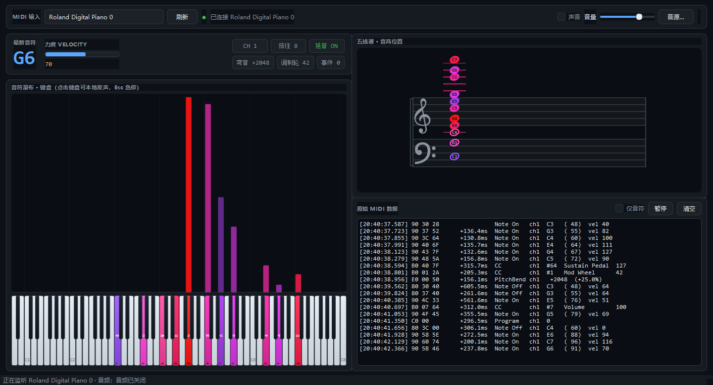

# MIDI 可视化（midi-visualizer）

一个用 Python 写的本机 MIDI 键盘可视化工具：**按键时实时显示原始 MIDI 数据**，在 88 键钢琴图上标出
按下的键、力度和延音状态，同时加载音源把声音放出来。



## 功能

| 功能 | 说明 |
| --- | --- |
| 实时读取键盘 | 通过 `mido` + `python-rtmidi` 读取系统 MIDI 输入端口，支持热插拔后刷新 |
| 原始数据 | 每条消息显示原始字节（如 `90 3C 60`）、与上一条的间隔（ms）、解析后的语义 |
| 键盘可视化 | 88 键（A0–C8），按下的键高亮，颜色由冷到暖表示力度，键底还有一条力度条 |
| 音符瀑布 | 每个音从对应琴键位置向上「升起」，条长 = 按住时长，颜色 = 力度，一眼看出旋律走向 |
| 五线谱 | 大谱表（高音谱 + 低音谱），实时标出按下的音在谱上的确切位置，升号用临时记号，音名直接写在音头里 |
| 力度 / 控制器 | 力度条、按键计数、通道、延音踏板（CC64）、弯音、调制轮（CC1）实时显示 |
| 声音 | 内置软音源（numpy 加法合成，装完就能出声），可选加载 `.sf2` SoundFont |
| 鼠标弹奏 | 直接点界面上的键盘也能发声，越靠下力度越大，方便没接键盘时试听 |
| 终端模式 | `--cli` 不开界面，直接在终端打印 MIDI 数据，方便调试 |

界面分两栏：顶栏选设备 / 开关声音 / 调音量 / 换音源。

* **左栏**：实时信息条 + 音符瀑布 + 88 键键盘。瀑布图横向直接复用琴键坐标，所以和下面的键盘严格逐键对齐，
  从 A0 到 C8 全音域都在同一张图里，高音区不会被别的东西挡住。
* **右栏**：上半是五线谱，下半是原始 MIDI 数据流（时间戳 · 原始字节 · 间隔 · 解析语义）。
  两栏、以及右栏的上下两块都能拖动分隔条重新分配空间。

### 五线谱怎么读

* 上方是高音谱（G 谱号）、下方是低音谱（F 谱号）；**中央 C** 落在两者之间，用自己的一条加线表示。
* 超出谱表的音会自动补加线（ledger line），所以 A0、C8 这种极端音也能正确定位。
* 音头是**实心**＝此刻正按着；**空心**＝已松手但被延音踏板（CC64）吊着。
* 颜色沿用键盘的力度色阶；音名（如 `C4`）直接写在音头里，和弦再密也不会找不到。
* 不设调号，所有黑键都用临时 `♯` 表示；同一时刻按下的音按和弦处理，音高太近时自动左右错开。
* 视窗默认框在 C2–C6，弹到范围外会自动撑大并缩小行距，不会把音裁掉。

## 快速开始

> 环境要求：**Python 3.11 / 3.12**。`python-rtmidi` 目前没有 3.13 的预编译包，
> 3.13 上安装会尝试本地编译并失败（本项目因此用 3.11 建的环境）。

```bash
cd midi
python -m venv .venv                 # 用 Python 3.11 创建
.venv\Scripts\activate               # Windows
pip install -r requirements.txt      # 慢的话加 -i https://pypi.tuna.tsinghua.edu.cn/simple

python main.py                       # 启动图形界面
python main.py --list-ports          # 看看有哪些 MIDI 输入设备
python main.py --cli                 # 终端监视模式
python main.py --no-audio            # 只看数据，不初始化声卡
python main.py --soundfont piano.sf2 # 指定音源文件
```

如果装不上 `python-rtmidi`，说明当前解释器没有对应的预编译包，换 3.11/3.12 即可。

## 目录结构

```
midi/
├─ main.py                        # 启动入口
├─ midi_visualizer/
│  ├─ core/
│  │  ├─ midi_input.py            # ★ 可复用的 MIDI 输入模块（不依赖界面）
│  │  └─ notes.py                 # 音名 / 频率 / 黑键判断
│  ├─ audio/
│  │  ├─ synth.py                 # 内置多复音合成器（包络 + 泛音）
│  │  └─ engine.py                # 音频后端：内置合成器 / SoundFont / 静默
│  ├─ ui/
│  │  ├─ piano_widget.py          # 88 键键盘控件
│  │  ├─ note_trail.py            # 音符瀑布图（与键盘共用键位坐标）
│  │  ├─ staff_widget.py          # 五线谱（大谱表 / 谱号 / 加线 / 临时记号）
│  │  ├─ main_window.py           # 主窗口
│  │  └─ theme.py                 # 深色主题与样式表
│  ├─ cli.py                      # 终端监视模式
│  └─ app.py                      # 命令行参数解析
├─ demo/cli_monitor.py            # 模块复用示例
├─ tools/preview_shot.py          # 生成 README 里的界面预览图
└─ tests/test_core.py             # 单元测试（不需要设备/声卡）
```

## 复用 MIDI 输入模块

`midi_visualizer/core/midi_input.py` 刻意做成**零界面依赖**，只依赖 `mido` + `python-rtmidi`，
复制到别的项目里（或 `pip install -e .` 后直接 import）就能用。三种用法：

```python
from midi_visualizer.core.midi_input import MidiInput, list_input_ports

# 1) 阻塞迭代（脚本 / 后台线程）
print(list_input_ports())                    # ['Arturia KeyStep 32', ...]
with MidiInput() as midi:                    # 不传端口 = 自动打开第一个
    midi.open("Arturia KeyStep 32")
    for event in midi:
        print(event.hex, event.describe())   # 90 3C 60  Note On ch1 C4 (60) vel 96

# 2) 回调（回调跑在 MIDI 后台线程，别在里面碰 UI）
def on_note_on(ev):
    print("按下", ev.note_name, ev.velocity)

midi = MidiInput(port="Arturia KeyStep 32", callbacks={"note_on": on_note_on})
midi.open()
midi.close()

# 3) GUI：非阻塞取事件（本项目就是这么用的，60fps 定时器里 drain）
midi = MidiInput(port=0)
midi.open()
events = midi.drain()        # -> list[MidiEvent]，队列空则为 []
```

### `MidiEvent` 字段

| 字段 | 说明 |
| --- | --- |
| `raw` | 原始字节 `bytes`，如 `b'\x90\x3c\x60'` |
| `hex` | 原始字节的十六进制字符串 `90 3C 60` |
| `status` / `type` | 状态字节 / 消息类型（`note_on`、`control_change`、`pitch_bend`…） |
| `channel` | 1–16（系统消息为 0） |
| `data1` / `data2` | 两个数据字节 |
| `note` / `velocity` / `note_name` | 音符、力度、音名（如 `C4`） |
| `control` / `value` | CC 编号与值 |
| `bend` | 弯音值 −8192…+8191 |
| `is_note_on` / `is_note_off` / `is_sustain` | 语义判断 |
| `timestamp` | `time.perf_counter()` 时间戳，用于算间隔 |
| `describe()` | 一行人类可读描述 |

解析是**自己按原始字节做的**，不经过 `mido.Message` 的规范化，所以看到的一定是键盘真正发出的东西
（比如很多键盘松键发的是 `note_on + 力度 0`，这里会保留原样，但 `is_note_off` 仍然是 `True`）。

## 声音

* 默认用**内置软音源**（`audio/synth.py`）：加法合成 + ADSR 包络，力度同时影响音量和泛音亮度，
  支持多复音（默认 48 声部）、延音踏板、弯音。不需要任何音源文件。
* 想更真实可以点工具栏的 **「音源…」** 选一个 `.sf2` 文件（如 GeneralUser GS、FluidR3）。
  这需要额外装 `pyfluidsynth`，且 Windows 上还要把 `fluidsynth` 的 DLL 放进 PATH 或项目目录；
  加载失败会自动退回内置合成器，不会影响数据显示。

## 快捷键

| 快捷键 | 作用 |
| --- | --- |
| `空格` | 暂停 / 继续滚动日志 |
| `Ctrl+L` | 清空日志 |
| `Ctrl+R` | 重新扫描 MIDI 设备 |
| `Esc` | 急停：关掉所有正在发声的音符 |

## 测试

```bash
.venv\Scripts\python.exe -m unittest discover -s tests -v
```

覆盖 MIDI 字节解析（含 `note_on + vel 0`、14bit 弯音、单数据字节的 program change）、音名/频率换算、
五线谱音级定位（各谱表十条线是否精确对上、升号不改变音级）、合成器的发声与回收、延音踏板、复音数上限。

## 常见问题

**列不出设备 / 显示"未检测到 MIDI 设备"**
键盘用 USB 连上后，Windows 会在系统里注册 MIDI 设备；确认其它 MIDI 软件没有独占它，
然后点界面上的「刷新」或按 `Ctrl+R`。

**装 `python-rtmidi` 报 "Compiler cl cannot compile programs"**
当前 Python 版本没有预编译包，降级到 3.11 / 3.12 建虚拟环境即可。

**没有声音**
先看工具栏右侧的音源标签和状态栏提示；如果是 `无音频`，通常是没选到可用的输出设备
（`sounddevice` 打不开声卡）。可先用 `python main.py --no-audio` 确认数据链路正常。

**日志滚太快**
点「暂停」（或空格）先冻住画面，勾选「仅音符」过滤掉 CC/弯音这类高频消息。

**五线谱只显示 G / F 两个字母，没有谱号**
说明系统里没有能渲染音乐符号的字体。Windows 自带的 **Segoe UI Symbol** 就够用；
程序会依次尝试 Bravura / Noto Music / Segoe UI Symbol，都找不到时降级成 G、F 字母示意
（不影响音高定位，只影响谱号外观）。
